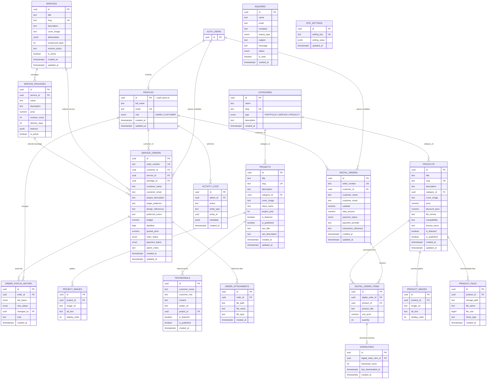

# 03 — Database Relationship Diagram & Schema

> Phase 1 deliverable. Supabase PostgreSQL. All tables use UUID primary keys.

## 3.1 Entity–relationship diagram



## 3.2 Relationship inventory

| Parent | Child | Cardinality | FK behaviour |
|---|---|---|---|
| `auth.users` | `profiles` | 1 : 0..1 | `profiles.id` = `auth.users.id`, `ON DELETE CASCADE` |
| `auth.users` | `service_orders` | 1 : 0..n | `customer_id` **nullable** (guest checkout), `ON DELETE SET NULL` |
| `auth.users` | `digital_orders` | 1 : 0..n | `customer_id` **nullable** (guest checkout), `ON DELETE SET NULL` |
| `categories` | `projects` | 1 : 0..n | `category_id` nullable, `ON DELETE SET NULL` |
| `categories` | `products` | 1 : 0..n | `category_id` nullable, `ON DELETE SET NULL` |
| `projects` | `project_images` | 1 : 0..n | `ON DELETE CASCADE` |
| `projects` | `testimonials` | 1 : 0..n | `project_id` nullable, `ON DELETE SET NULL` |
| `services` | `service_packages` | 1 : 0..n | `ON DELETE CASCADE` |
| `services` | `service_orders` | 1 : 0..n | `ON DELETE RESTRICT` — never orphan an order |
| `service_packages` | `service_orders` | 1 : 0..n | `package_id` nullable, `ON DELETE SET NULL` |
| `service_orders` | `order_attachments` | 1 : 0..n | `ON DELETE CASCADE` |
| `service_orders` | `order_status_history` | 1 : 0..n | `ON DELETE CASCADE` |
| `digital_orders` | `digital_order_items` | 1 : 1..n | `ON DELETE CASCADE` |
| `products` | `digital_order_items` | 1 : 0..n | `product_id` nullable, `ON DELETE SET NULL` |
| `products` | `product_images` | 1 : 0..n | `ON DELETE CASCADE` |
| `products` | `product_files` | 1 : 0..n | `ON DELETE CASCADE` |
| `digital_order_items` | `downloads` | 1 : 0..1 | `ON DELETE CASCADE` |
| `profiles` | `activity_logs` | 1 : 0..n | `ON DELETE SET NULL` |
| `profiles` | `order_status_history` | 1 : 0..n | `changed_by` nullable, `ON DELETE SET NULL` |

## 3.3 Enumerated domains

```sql
CREATE TYPE profile_role        AS ENUM ('ADMIN', 'CUSTOMER');
CREATE TYPE category_type       AS ENUM ('PORTFOLIO', 'SERVICE', 'PRODUCT');
CREATE TYPE service_order_status AS ENUM (
  'NEW_INQUIRY', 'CONTACTED', 'QUOTED', 'WAITING_FOR_PAYMENT',
  'IN_PROGRESS', 'REVISION', 'COMPLETED', 'CANCELLED'
);
CREATE TYPE payment_status      AS ENUM ('PENDING', 'PAID', 'FAILED', 'REFUNDED');
CREATE TYPE inquiry_type        AS ENUM (
  'GENERAL', 'DESIGN_SERVICE', 'COLLABORATION', 'PARTNERSHIP', 'OTHER'
);
CREATE TYPE inquiry_status      AS ENUM ('NEW', 'IN_PROGRESS', 'RESOLVED', 'SPAM');
```

`payment_status` is shared by `service_orders` and `digital_orders` — the spec lists it identically under both (§6) and defines the four values once (§5.F).

## 3.4 Constraints and integrity

| Rule | Enforcement |
|---|---|
| Slug uniqueness | `UNIQUE (slug)` on `projects`, `services`, `products`, `categories` |
| Order-number uniqueness | `UNIQUE (order_number)` on `service_orders`, `digital_orders` |
| Email uniqueness | `UNIQUE (email)` on `profiles` |
| Discount sanity | `CHECK (discount_price IS NULL OR discount_price < price)` on `products` |
| Price sanity | `CHECK (price >= 0)`, `CHECK (budget IS NULL OR budget >= 0)`, `CHECK (quoted_price IS NULL OR quoted_price >= 0)` |
| Revision / delivery sanity | `CHECK (revision_count >= 0)`, `CHECK (delivery_days > 0)`, `CHECK (turnaround_days > 0)` |
| Quantity sanity | `CHECK (quantity > 0)` on `digital_order_items` |
| Display order | `CHECK (display_order >= 0)` on image tables |
| Year sanity | `CHECK (project_year BETWEEN 2000 AND 2100)` |
| Package ↔ service consistency | Composite FK: `service_packages (id, service_id)` ← `service_orders (package_id, service_id)` — a package from another service cannot be ordered. Enforced by a `UNIQUE (id, service_id)` on `service_packages`. |
| Immutable order number | `order_number` has a `BEFORE INSERT` trigger generating `SO-YYYYMM-XXXX` / `DO-YYYYMM-XXXX` from a per-prefix sequence, so the client cannot choose it. |
| Timestamp integrity | `updated_at` maintained by a shared `set_updated_at()` trigger on all 8 tables carrying it. |
| Deletion safety | Deleting a `projects`/`products`/`services` row is blocked while published/referenced (`is_published` or FK children) unless the admin explicitly unpublishes first. |

## 3.5 Indexes

| Table | Index | Type | Purpose |
|---|---|---|---|
| `projects` | `idx_projects_slug` | btree unique | Slug lookup (§6) |
| `projects` | `idx_projects_published_featured` | partial (`WHERE is_published`) | Public featured queries |
| `projects` | `idx_projects_category_id` | btree | FK + category filter |
| `projects` | `idx_projects_created_at` | btree desc | Recency ordering |
| `projects` | `idx_projects_search` | GIN `to_tsvector('simple', title \|\| ' ' \|\| description)` | Title search (§4.B) |
| `project_images` | `idx_project_images_project_order` | `(project_id, display_order)` | Gallery ordering |
| `services` | `idx_services_slug` | btree unique | Slug lookup |
| `services` | `idx_services_active` | partial (`WHERE is_active`) | Public catalogue |
| `service_packages` | `idx_service_packages_service` | btree | FK + package list |
| `service_packages` | `uq_service_packages_id_service` | unique `(id, service_id)` | Composite FK target |
| `service_orders` | `idx_service_orders_order_number` | btree unique | Order lookup (§6) |
| `service_orders` | `idx_service_orders_status` | btree | Status filter (§5.D) |
| `service_orders` | `idx_service_orders_customer` | btree | Customer scoping |
| `service_orders` | `idx_service_orders_email` | btree | Admin email search |
| `service_orders` | `idx_service_orders_created_at` | btree desc | Recent orders |
| `order_status_history` | `idx_osh_order` | btree | Timeline |
| `products` | `idx_products_slug` | btree unique | Slug lookup |
| `products` | `idx_products_published_featured` | partial | Public featured queries |
| `products` | `idx_products_category_id` | btree | FK + category filter |
| `products` | `idx_products_created_at` | btree desc | Recency ordering |
| `products` | `idx_products_search` | GIN tsvector | Product search (§4.F) |
| `product_images` | `idx_product_images_product_order` | `(product_id, display_order)` | Gallery ordering |
| `product_files` | `idx_product_files_product` | btree | FK |
| `digital_orders` | `idx_digital_orders_order_number` | btree unique | Order lookup (§6) |
| `digital_orders` | `idx_digital_orders_payment_status` | btree | Payment filter (§5.F) |
| `digital_orders` | `idx_digital_orders_customer` | btree | Customer scoping |
| `digital_orders` | `idx_digital_orders_created_at` | btree desc | Revenue-by-period aggregation |
| `digital_order_items` | `idx_doi_order` | btree | FK + join |
| `digital_order_items` | `idx_doi_product` | btree | FK |
| `downloads` | `idx_downloads_item` | btree unique | 1:1 tracking |
| `inquiries` | `idx_inquiries_email` | btree | Admin email search |
| `inquiries` | `idx_inquiries_status` | btree | Status filter |
| `inquiries` | `idx_inquiries_created_at` | btree desc | Recent inquiries |
| `profiles` | `idx_profiles_email` | btree unique | Lookup by email |
| `profiles` | `idx_profiles_role` | btree | Customer listing (§5) |
| `activity_logs` | `idx_activity_logs_admin` | btree | FK |
| `activity_logs` | `idx_activity_logs_created_at` | btree desc | Recent activity (§5.A) |

## 3.6 JSONB usage (constrained, per §6)

JSONB is used **only** for flexible structured content, exactly as the spec permits:

| Column | Shape |
|---|---|
| `services.deliverables` | `["Logo primary", "Brand guide PDF", ...]` |
| `service_packages.features` | `["3 revision rounds", "Source files", ...]` |
| `site_settings.setting_value` | Object/array per key (studio name `ngantuqan`, tagline, social links, logo URL, homepage content blocks, legal-page bodies, theme config) |
| `activity_logs.metadata` | Free-form audit context |

Everything with a fixed shape (prices, statuses, slugs, dates) lives in a typed column.

## 3.7 Row Level Security policy matrix

`public.is_admin()` and `public.current_customer_id()` are `SECURITY DEFINER` helpers (they bypass RLS on `profiles` to avoid recursive policy evaluation).

| Table | anon | authenticated customer | authenticated admin |
|---|---|---|---|
| `profiles` | — | own row only (`id = auth.uid()`) | all rows |
| `categories` | `SELECT` (published types) | `SELECT` | `ALL` |
| `projects` | `SELECT WHERE is_published` | `SELECT WHERE is_published` | `ALL` |
| `project_images` | `SELECT` (via published project) | same | `ALL` |
| `services` | `SELECT WHERE is_active` | same | `ALL` |
| `service_packages` | `SELECT WHERE is_active` (via active service) | same | `ALL` |
| `products` | `SELECT WHERE is_published` | same | `ALL` |
| `product_images` | `SELECT` (via published product) | same | `ALL` |
| `product_files` | **none** | **none** — path is never exposed; access only via signed URL | `SELECT` |
| `service_orders` | `INSERT` only (own submission) | `SELECT`/`UPDATE` own (`customer_id = auth.uid()`) | `ALL` |
| `order_attachments` | `INSERT` only (own order) | `SELECT` own order's | `ALL` |
| `order_status_history` | none | `SELECT` own order's | `ALL` |
| `digital_orders` | `INSERT` only | `SELECT` own | `ALL` |
| `digital_order_items` | `INSERT` only | `SELECT` own order's | `ALL` |
| `downloads` | none | `SELECT` own order's | `ALL` |
| `inquiries` | `INSERT` only | `SELECT` own? **No** — `SELECT` none | `ALL` |
| `testimonials` | `SELECT WHERE is_published` | same | `ALL` |
| `site_settings` | `SELECT` (public-safe keys only) | same | `ALL` |
| `activity_logs` | none | none | `ALL` |

`site_settings` uses a **row-level key filter** so the public role can only read keys marked public (e.g. `studio.name`, `studio.tagline`, `seo.defaults`, `home.*`, `legal.*`), while sensitive keys (payment config, internal notes) are admin-only.

### Storage policies

| Bucket | `public-media` | `private-products` | `private-attachments` |
|---|---|---|---|
| Public read | ✅ yes | ❌ no | ❌ no |
| Public write | ❌ no | ❌ no | ❌ no |
| Admin read | ✅ | ✅ | ✅ |
| Admin write | ✅ | ✅ | ✅ |
| Customer read | n/a | ❌ direct — **signed URL only**, minted server-side after verifying `payment_status = 'PAID'` | ❌ direct — signed URL only, admin-triggered |

## 3.8 Migration file plan

| File | Contents |
|---|---|
| `supabase/migrations/0001_extensions_and_enums.sql` | `pgcrypto`, enum types |
| `0002_tables.sql` | All 20 tables + indexes + constraints |
| `0003_triggers.sql` | `set_updated_at()`, order-number generation, profile auto-creation on signup, delete guards |
| `0004_rls_policies.sql` | Enable RLS on all tables, `is_admin()` / `current_customer_id()` helpers, full policy set |
| `0005_storage.sql` | Bucket creation + storage policies |
| `0006_functions.sql` | `generate_order_number()`, `record_purchase()`, `record_download()`, `admin_revenue_summary()` (revenue counts only PAID rows) |
| `supabase/seed.sql` | Demo categories, services, projects, products, testimonials — **all clearly labelled `DEMO —`** (§15) |
| `supabase/README.md` | Apply order, how to create the first admin, how to point the app at the project |

## 3.9 Seed data policy (§15 compliance)

- Every seeded row carries a `DEMO` marker in its title/name (`"DEMO — Aurora Coffee Rebrand"`).
- Seeded testimonials are authored as clearly fictional sample copy and are labelled `DEMO` in the `customer_role` field.
- Seeded products reference no real files; `product_files` rows are omitted so nothing is downloadable in demo state.
- **No fabricated revenue.** The seed creates zero `PAID` digital orders, so the admin revenue panel shows `Rp 0` on a fresh install rather than invented numbers.
- The `site_settings` seed writes `studio.name = "ngantuqan"` and `studio.tagline = "Creative Design Studio & Digital Marketplace"` (the descriptive default — see C24).
